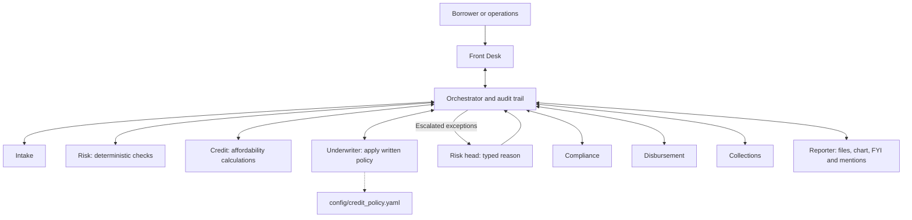

# Lendix

**A lending office run by AI agents, end to end.**


[](.github/workflows/tests.yml)

Lendix Finance is a fictional lender with nine agents and 25 synthetic applications. Its Underwriter applies a written policy: decline a mismatched account, approve a clean ₹1 lakh loan, or escalate a ₹3 lakh exception to the risk head. Every outcome comes with its rule, evidence and documents.

**Build status:** the local console, policy engine, documents and mocked lifecycle flows work. Gemini wiring is implemented; live validation needs your key and model IDs. The Nonilion adapter awaits its Bot API guide. A hosted deployment and live office connection have not been verified.

## The problem

Small lenders drown in manual document checks, affordability calculations and paperwork. Fraud can slip through mismatched details. A written policy should produce consistent decisions, explain each result and send exceptions to the people best equipped to resolve them.

## Who it is for

- **The risk team:** writes the credit policy, receives FYI updates on automatic decisions and handles exceptions.
- **The risk head:** approves, approves a reduced amount or declines escalated applications, always with a typed reason.
- **Operations and borrowers:** exchange documents, accept disclosures, track simulated repayments and request support.

The public demo role selector demonstrates permissions; it is not authentication or borrower data isolation. All data must remain synthetic.

## The agent team and handoffs



Every handoff goes through the orchestrator and is recorded. Agents do not call one another. Python determines risk, affordability and decisions. The model supplies routing, extraction and short explanations.

## The agents

| Agent | Role and tools | Produces |
|---|---|---|
| Front Desk | Route requests and log grievances: `list_loans`, `get_loan`, `route`, `log_grievance` | Replies, clarification and grievance acknowledgment |
| Intake | Collect and validate facts: `parse_upload`, `validate_application`, `request_document` | Acknowledgment, missing-item request, consent JSON/PDF, KYC summary |
| Risk | Run six fixed rules: `run_risk_checks` | Reason codes, band, report and chart inputs |
| Credit | Calculate numbers: `compute_affordability`, `bureau_lookup` | FOIR, max EMI, eligible amount, tenure and APR |
| Underwriter | Apply policy and explain its rule: `apply_policy`, `draft_decision_note`, `escalate` | Logged decision or escalation and decision-note PDF |
| Compliance | Enforce boundaries: `check_message`, `check_document`, `check_disbursement` | Allowed/blocked result and reasons |
| Disbursement | Issue terms and simulate payout: `make_kfs`, `simulate_payout` | Sanction, KFS, agreement summary and simulated advice |
| Collections | Service the loan: `emi_schedule`, `record_payment`, `draft_reminder`, `request_restructure` | Schedule, receipts, polite reminders, hardship note and No Dues Certificate |
| Reporter | Render and deliver: `make_document`, `make_chart`, `post_update`, `mention` | PDF, CSV, Excel, JSON, PNG, progress, FYIs and mentions |

## A lifecycle walkthrough

| Stage | Action | Documents and outputs |
|---|---|---|
| Application | Ask for one missing item at a time; record explicit consent | Acknowledgment PDF/chat, missing-documents checklist, consent JSON/PDF, KYC PDF |
| Risk | Compare identity, payout name, phone age, recent applications, shared accounts and income | Risk report PDF and PNG |
| Credit | Compute affordability with a 50% FOIR cap | Deterministic financial inputs for underwriting |
| Underwriting | Apply decline rules first, approval rules second, otherwise escalate | Decision-note PDF with policy version, rule, input snapshot and reasons |
| Automatic outcome | Approve or decline by policy; post an FYI to the risk team | Sanction/KFS or rejection PDF/chat, decision note and chart |
| Escalation | Mention the risk head and request an office walk; wait for a reasoned decision | Escalated queue, note/chart and risk-head decision audit |
| KFS and payout | Record borrower acceptance, enforce waiting and verified-account gates | KFS, agreement summary, simulated disbursement advice |
| Collections | Schedule installments and record simulated payments | Repayment CSV/PDF, receipt PDF, reminder chat |
| Hardship and closure | Escalate restructure requests; settle the synthetic loan | Restructure note, escalation decision note, No Dues Certificate |
| Oversight | Acknowledge complaints and export review results | Grievance PDF/chat, queue CSV/Excel with outcome counts, dashboard PNG, risk-head-only audit JSON |

Every artifact carries a loan ID, date, recorded document ID and **SPECIMEN · SYNTHETIC DEMO DATA · NOT A LEGAL DOCUMENT** watermark. Downloads use random tokens that expire after 24 hours. Interrupted document operations can be retried without repeating their simulated transactions.

## How it uses Nonilion

The working `LocalAdapter` displays chat, files, charts, risk-team FYIs, risk-head mentions and office-action events in the console. SSE shows handoffs, tools and statuses. Background batches acknowledge immediately, post progress and return reusable exports.

Lendix joins a Nonilion room through **Nonilion's MCP server** (`https://www.nonilion.com/mcp`), using a personal token from Mission Control → MCP. [`app/nonilion/office.py`](app/nonilion/office.py) runs inside the service when `NONILION_MCP_TOKEN` is set:

- **Front Desk is an avatar in the room.** It calls `listen` in a loop. A message such as `Review L-1043` runs the same pipeline as the console. The room owner speaks as the risk head; a prefix such as `borrower:` or `ops:` picks another demo role.
- **The office log is mirrored into the room.** The working agent's step appears as an avatar status, decisions are said out loud, replies come back in the agent chat, and issued PDFs are posted to room chat (this needs an HTTPS `PUBLIC_BASE_URL`).
- **Escalations walk to the risk head.** Reporter walks up to the risk head (`NONILION_RISK_HEAD`, default the room owner) and sends a direct message with the case.
- **One avatar per token.** Front Desk's token is required. Optional `NONILION_TOKEN_<AGENT>` tokens (for example `NONILION_TOKEN_REPORTER`) give that agent its own avatar; other agents show through Front Desk's status line.

Office gestures are best effort: a failed Nonilion call is logged by tool name only and never blocks a loan decision. Tokens are never logged. `/healthz` reports `nonilion: connected` once the avatars are in the room.

The older webhook route (`POST /nonilion/webhook`) stays disabled: it rejects unverified requests, and `NonilionAdapter` remains a placeholder.

## Safety and compliance

[`config/credit_policy.yaml`](config/credit_policy.yaml) is validated at boot; an invalid, missing or ambiguous file stops startup. [`app/policy.py`](app/policy.py) evaluates:

1. Auto-decline for a configured hard fraud flag or FOIR above 50%.
2. Auto-approve when the band is `low`, amount is at most ₹2 lakh and FOIR is at most 50%.
3. Escalate every other case, plus explicit override and restructure requests.

Each decision records the policy version, exact fired rule, inputs and reasons. Model prose cannot alter that decision. Only `risk_head` may resolve an escalated credit application, and every approval or decline needs a specific typed reason. To change an automatic decision, the risk head first sends `override L-1043 because ...`; this opens an escalation and invalidates prior acceptance. A second reasoned decision is required. A servicing restructure request cannot be processed as a new-loan approval.

Payout gates require policy approval or a recorded risk-head approval on an escalated loan, accepted KFS, consent and the borrower's own verified account. Missing sources remain `unverified`. The configurable cooling-off period permits exit without penalty. `DEMO_SKIP_COOLING_OFF=1` skips the presentation's pre-payout wait; acceptance and exit rights remain. `exit L-1043` demonstrates withdrawal or a simulated cooling-off principal return.

Reminders are delivered only from 08:00 to before 19:00 IST; out-of-hours requests are queued for 08:00. Threats, shaming, third-party contact, social-media lookups and predictions about personal default are refused. Grievances receive a reference, 30-day window and RBI Ombudsman escalation information. The policy follows the demo expectations informed by the [RBI Digital Lending Directions](https://www.rbi.org.in/Scripts/BS_ViewMasDirections.aspx?id=12848); this is not a regulatory certification.

Secrets stay in environment variables. The app requires a Gemini key and model IDs at startup. `.env`, databases and generated files are ignored. Limits are 20 requests/IP/10 minutes and a persistent daily model-call budget. Uploads are at most 5 MB; CSV, JSON, PDF, PNG, JPG, DOCX and XLSX are bounded and parsed without execution. Images provide metadata only. Chat/upload content is delimited as untrusted data; tool allowlists, structured outputs and server authorization constrain actions. Spreadsheet exports neutralize formula-like text. API docs are disabled unless `ENV=dev`.

## The four demo scripts

Use a fresh seeded database. Wait for the activity feed to finish after each command, and select the indicated demo role. Set `DEMO_SKIP_COOLING_OFF=1` for the instant-payout presentation.

**1. L-1042: affordable, but a hard fraud flag**

| Role | Exact message |
|---|---|
| Ops | `review L-1042` |
| Ops | `add bank statement L-1042` |

FOIR is about 38%. The mismatched account and new number are flagged. The Underwriter automatically declines under **hard fraud flag**, sends a respectful rejection and posts an FYI with note/chart. No person decides this case.

**2. L-1043: ₹1 lakh through closure**

| Role | Exact message |
|---|---|
| Ops | `review L-1043` |
| Borrower | `accept KFS L-1043` |
| Ops | `disburse L-1043` |
| Borrower | `pay EMI L-1043` |
| Ops | `fast-forward L-1043` |

The policy automatically approves the low-band loan. Read the sanction and KFS before acceptance. The remaining steps produce the simulated advice, schedule, receipt and No Dues Certificate. No real money moves.

**3. L-1045: ₹3 lakh exception, reduced to ₹2 lakh**

| Role | Exact message |
|---|---|
| Ops | `review L-1045` |
| Risk head | `approve L-1045 at 200000 because Verified affordability and recorded mitigants support the reduced amount` |

The medium-band application appears in the Escalated panel, with note, chart and risk-head mention. The risk head's amount and reason are audited. Approval produces the sanction and KFS; acceptance and payout gates still apply.

**4. L-1044: hardship**

| Role | Exact message |
|---|---|
| Borrower | `I lost my job and can't pay L-1044` |

Collections responds with empathy, creates a restructure note and escalates to the risk head. No changed terms are promised.

For background work, send `Review today's 20 applications` as Ops. The batch posts progress and returns CSV/Excel counts of auto-approved, auto-declined and escalated applications, plus a dashboard. Try `Will this person default?`, `Message the borrower's employer L-1044`, and `approve it anyway` as Borrower to demonstrate refusals. `export audit log` is risk-head-only.

## Quick start

Use Python 3.12; [`.python-version`](.python-version) pins the patch version.

```bash
python3.12 -m venv .venv
.venv/bin/python -m pip install -r requirements.txt
cp .env.example .env
```

Set the key and available model IDs in `.env`, then run:

```bash
.venv/bin/python -m uvicorn app.main:app --env-file .env --reload
.venv/bin/python -m pytest -q
.venv/bin/python scripts/demo_run.py
# Offline rehearsal with fixed structured responses:
.venv/bin/python scripts/demo_run.py --mock
```

Open `http://127.0.0.1:8000` directly into the lending workspace (`/app` is an alias). Choose a demo role in the header; this is not authentication. `/office` shows the live pixel-art office, and `/office?tour=1` follows each handoff with the corresponding agent sheet. Fonts and assets are self-hosted; the pages need no CDN or build step.

The rehearsal script loads `.env` without replacing existing environment settings and writes an isolated database, event log and documents under `out/demo/`.

The official [`google-genai` SDK](https://ai.google.dev/gemini-api/docs/libraries) uses [structured outputs](https://ai.google.dev/gemini-api/docs/structured-output) and bounded [function calling](https://ai.google.dev/gemini-api/docs/function-calling). A normal review uses about four model calls. Only the Underwriter's explanatory note uses the deep model. Transient failures retry up to three times and are reported visibly.

**Deploy:** create a Render Blueprint from [`render.yaml`](render.yaml), which defines one web service and a 1 GB persistent disk. Set the following values in the dashboard. The exact start command is `uvicorn app.main:app --host 0.0.0.0 --port $PORT`; health check is `/healthz`. See the official [Blueprint reference](https://render.com/docs/blueprint-spec) and [disk guide](https://render.com/docs/disks).

| Variable | Render value |
|---|---|
| `GEMINI_API_KEY` | Your private key |
| `GEMINI_MODEL_FAST` | An available Flash-tier model ID |
| `GEMINI_MODEL_DEEP` | An available Pro-tier model ID |
| `DB_PATH` | `/var/data/lendix.db` |
| `OUTPUT_DIR` | `/var/data/files` |
| `CREDIT_POLICY_PATH` | `config/credit_policy.yaml` |
| `ENV` | `production` |
| `PUBLIC_BASE_URL` | The service's HTTPS URL, without a trailing slash |
| `MAX_LLM_CALLS_PER_DAY` | `500` |
| `COOLING_OFF_DAYS` | `1` |
| `DEMO_SKIP_COOLING_OFF` | `1` for the synthetic presentation, otherwise `0` |
| `NONILION_DEV_ALLOW_UNVERIFIED` | `0` |
| `NONILION_PAIRING_CODE` | Leave unset until the documented integration is implemented |
| `NONILION_BOT_TOKEN` | Leave unset (webhook route not used) |
| `NONILION_MCP_TOKEN` | Front Desk's personal token from Mission Control → MCP |
| `NONILION_RISK_HEAD` | Optional: the risk head's Nonilion name; defaults to the room owner |
| `PORT` | Supplied by Render |

Use one process with SQLite. Jobs interrupted by restart are marked for retry; completed transactions and policy audits remain recorded.

## Limits and what's next

- Implement the documented Nonilion pairing, verification, delivery and office actions before the live-office judging requirement is met.
- Verify the real Gemini flow after setting credentials and model IDs; offline tests cannot validate access to a live model.
- Payouts, bureau data, identity fixtures, repayments and settlements are simulated. Uploaded content does not prove identity or income. No OCR is performed.
- Add authenticated identities, borrower ownership, private file authorization, durable workers, backups and retention before handling real information.
- Restructure requests are prepared and escalated; revised servicing terms require a separate approval process.

## The team

- **Product and credit policy:** [Name]
- **Agent orchestration and integration:** [Name]
- **Experience, documents and demo:** [Name]

Released under the [MIT License](LICENSE).
