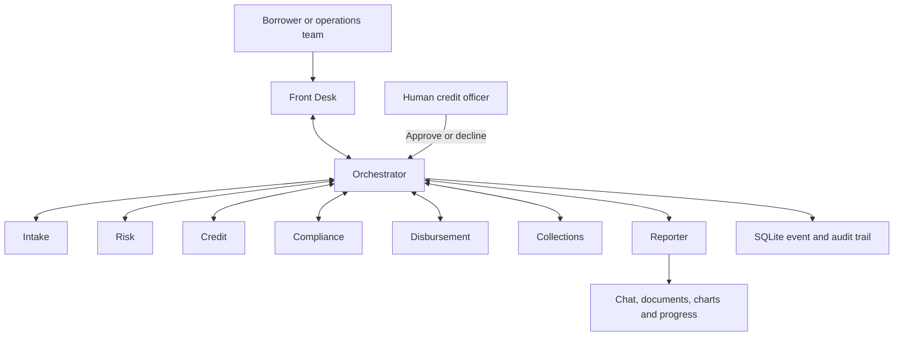

# Saakh

**A lending office where AI agents do the paperwork and a human makes the call.**


[](.github/workflows/tests.yml)

Saakh Finance is a fictional lender with eight specialist agents, 25 synthetic applications, visible handoffs and usable loan documents. Watch a mismatched payout account become a risk report, an officer decision and a respectful rejection letter. Follow a clean loan through disclosures, a simulated payout, repayments and closure.

**Current status:** the local console and mocked end-to-end flows are implemented and tested. Real Gemini wiring is implemented; a live run requires your key and model IDs. The Nonilion adapter is an explicit stub awaiting its Bot API guide. No live Nonilion connection or hosted deployment is claimed.

## The problem

Small lenders spend hours assembling applications, checking documents, reconciling names, calculating affordability and preparing letters. Details can disagree across those records, and a risky payout account can slip through. Officers need a traceable case with clear reasons and complete paperwork before making a decision.

## Who it is for

- **Credit officers:** review evidence, decide each application and explain any high-risk override.
- **Operations teams:** collect missing documents, prepare disclosures, track payments and handle queues.
- **Borrowers:** receive clear requests, understandable decisions and respectful support when repayment becomes difficult.

The console is a public demonstration with synthetic data. Its role selector demonstrates workflow permissions; it is **not authentication** and does not isolate one borrower's data from another.

## The agent team and handoffs



Agents have their own instructions, output schemas and tool allowlists. They hand work through the orchestrator. Python computes risk bands, affordability, EMI schedules and document fields. Gemini extracts supplied facts and drafts short explanations; it never determines the numeric risk result or approves credit.

## The agents

| Agent | Role | Tools | Produces |
|---|---|---|---|
| Front Desk | Route requests, clarify and log grievances | `list_loans`, `get_loan`, `route`, `log_grievance` | Replies, follow-up questions, grievance acknowledgment |
| Intake | Validate application fields, documents and explicit consent | `parse_upload`, `validate_application`, `request_document` | Application acknowledgment, missing-item request, consent record, KYC summary |
| Risk | Apply six deterministic verification rules | `run_risk_checks` | Reason codes, risk report, inputs for a risk chart |
| Credit | Calculate affordability and recommend an outcome | `compute_affordability`, `bureau_lookup`, `draft_decision_note` | Officer appraisal with FOIR, EMI, eligible amount and APR |
| Compliance | Check messages, documents and payout prerequisites | `check_message`, `check_document`, `check_disbursement` | Allowed/blocked result with reasons |
| Disbursement | Issue terms and simulate an authorized payout | `make_kfs`, `simulate_payout` | Sanction letter, KFS, agreement summary, simulated disbursement advice |
| Collections | Record payments and support borrowers in difficulty | `emi_schedule`, `record_payment`, `draft_reminder`, `request_restructure` | Schedules, receipts, reminders, restructure note, No Dues Certificate |
| Reporter | Render artifacts and report progress | `make_document`, `make_chart`, `post_update`, `mention` | PDFs, CSV, Excel, JSON, charts and officer mentions |

## A lifecycle walkthrough

| Stage | What happens | Artifacts |
|---|---|---|
| Application | Intake asks for one missing item at a time and records consent | Acknowledgment PDF + chat; missing-documents checklist; consent JSON + PDF; KYC summary PDF |
| Risk | Check payout names, DOB, recent applications, shared accounts, phone age and income gaps | Risk report PDF + PNG chart |
| Credit review | Apply a 50% FOIR cap and calculate amount, EMI and APR | Credit appraisal / decision note PDF |
| Officer decision | An officer approves, approves a lower amount or declines | Sanction PDF or rejection PDF + chat |
| Disclosures | Show all fees, APR, repayments, cooling-off terms and grievance contact; record borrower acceptance | KFS PDF; loan agreement summary PDF |
| Simulated payout | Check human approval, accepted KFS, waiting gate and the borrower's verified account | Disbursement advice PDF with simulated UTR |
| Collections | Produce the amortization schedule, record simulated payments and send polite reminders during permitted hours | Schedule CSV + PDF; receipt PDF; reminder chat |
| Hardship and closure | Refer changed terms to an officer; close only through an explicit simulated settlement | Restructure request PDF; No Dues Certificate PDF |
| Grievances and oversight | Acknowledge complaints, list cases and export recorded actions | Grievance acknowledgment PDF + chat; review queue CSV + Excel; portfolio PNG; officer-only audit JSON |

Templates live in [`app/documents/`](app/documents/). Generated artifacts include a loan ID, date, short document ID and the watermark **“SPECIMEN · SYNTHETIC DEMO DATA · NOT A LEGAL DOCUMENT.”** IDs are recorded in the audit trail. Download links use random tokens and expire after 24 hours.

## How it uses Nonilion

The transport contract supports `on_message`, `send_reply`, `send_file`, `post_update`, `mention` and `office_action`. The working `LocalAdapter` displays chat, files, charts, officer mentions, progress and office-action events in the web console. Its Server-Sent Events feed shows each handoff, tool invocation and agent status. Batch jobs return immediately and publish results as work completes.

The intended office integration uses Nonilion's **Connect a bot** route. [`NonilionAdapter`](app/nonilion/adapter.py) deliberately raises `NotImplementedError("fill from the Nonilion Bot API guide")`. Before a live demo, the guide must supply the webhook schema, origin verification, reply/file/mention/office-action endpoints and pairing flow. Room knowledge search, presence and movement cannot run until those capabilities are documented and implemented.

`POST /nonilion/webhook` rejects unverified requests by default. Setting `NONILION_DEV_ALLOW_UNVERIFIED=1` enables a development-only acknowledgment test: the endpoint returns HTTP 200 immediately and queues work, which then reports that the adapter is not implemented. This flag does **not** connect the office. Pairing and a reply inside Nonilion remain necessary before the entry meets the live-office requirement.

## Safety and compliance

- Every approval or decline requires the `credit_officer` role. A high-risk override requires a typed reason and an audit entry; payout safeguards still apply.
- Missing verification sources produce `unverified`, never `low`. The system explains observed flags and refuses predictions about whether a person will default.
- A payout needs human approval, an accepted KFS and the borrower's own verified account. All payouts and collections are simulated.
- The configurable cooling-off period is at least one day. The demo also has a waiting gate before payout. `DEMO_SKIP_COOLING_OFF=1` skips that waiting gate for a presentation; the recorded exit-without-penalty option remains available.
- Reminder delivery is limited to 08:00 through before 19:00 IST. Out-of-hours requests are queued for 08:00. Threats, shaming, social-media lookups and contact with family, friends or employers are refused.
- Grievances receive a reference and a 30-day resolution window, with an explanation of escalation to the RBI Ombudsman.
- Uploads are capped at 5 MB and restricted to CSV, JSON, PDF, PNG, JPG, DOCX and XLSX. Documents are parsed as text or read-only cells. Images yield metadata only; no OCR or identity verification is invented. Archive expansion and file signatures are checked.
- Chat and uploaded content are untrusted model input. Schemas, tool allowlists and deterministic authorization checks constrain actions. CSV/Excel exports neutralize formula-like text.
- Secrets come from environment variables. `.env`, databases and generated artifacts are ignored by git. The app refuses to start without its Gemini key and model IDs. Rate limits allow 20 messages per IP per 10 minutes, with a separate daily model-call budget. API documentation is disabled unless `ENV=dev`.

The demo policy draws on the [RBI Digital Lending Directions](https://www.rbi.org.in/Scripts/BS_ViewMasDirections.aspx?id=12848), including borrower disclosures, direct disbursement, cooling-off and grievance handling. This prototype is not a regulatory certification or a production lending system. Its simplified waiting and simulated settlement flows must be reviewed before any real deployment.

## The three demo scripts

Use a fresh seeded database and wait for each request to finish in the activity feed. Select the indicated role before sending each exact message. For the clean-loan presentation, set `DEMO_SKIP_COOLING_OFF=1` before starting the server.

**1. The mismatched loan: L-1042**

| Role | Message |
|---|---|
| Ops | `review L-1042` |
| Ops | `add bank statement L-1042` |
| Credit officer | `decline L-1042` |

Intake requests the missing synthetic statement. The completed review flags `PAYOUT_NAME_MISMATCH` and `NEW_NUMBER`, prepares a decision note and risk chart, and mentions the officer. The officer's decline produces a letter explaining how to correct the payout account.

**2. A clean loan through closure: L-1043**

| Role | Message |
|---|---|
| Ops | `review L-1043` |
| Credit officer | `approve L-1043` |
| Borrower | `accept KFS L-1043` |
| Ops | `disburse L-1043` |
| Borrower | `pay L-1043` |
| Ops | `fast-forward L-1043` |

Open the sanction letter and KFS before acceptance. The remaining steps produce a simulated payout, repayment CSV/PDF, EMI receipt and No Dues Certificate. Fast-forward explicitly settles the remaining synthetic installments; it is not a real payment operation.

**3. Hardship without harassment: L-1044**

| Role | Message |
|---|---|
| Borrower | `I lost my job and can't pay L-1044` |

Collections acknowledges the difficulty, drafts a restructure request and mentions the officer. It promises no revised terms.

For the background demonstration, use Ops and send `Review today's 20 applications`. Seed dates are refreshed for the demo when a new database is created; batch selection uses today's pending records. Progress appears every few applications, followed by CSV, Excel and a portfolio chart. Further checks: `Will this person default?`, `Message the borrower's employer L-1044`, and `approve L-1042` as Borrower. Only the officer can send `export audit log`.

## Quick start

Use Python 3.12. The patch version is pinned in [`.python-version`](.python-version).

```bash
python3.12 -m venv .venv
.venv/bin/python -m pip install -r requirements.txt
cp .env.example .env
```

Edit `.env` locally. Set `GEMINI_API_KEY`, an available Flash-tier ID for `GEMINI_MODEL_FAST`, and an available Pro-tier ID for `GEMINI_MODEL_DEEP`. Model IDs are read from the environment. Do not put credentials in terminal output or tracked files.

```bash
.venv/bin/python -m uvicorn app.main:app --env-file .env --reload
```

Open `http://127.0.0.1:8000`. The console has chat, a role selector, uploads, a live activity feed and a documents panel. `/healthz` reports service status and that Nonilion is not connected.

The integration uses the official [`google-genai` SDK](https://ai.google.dev/gemini-api/docs/libraries), [structured outputs](https://ai.google.dev/gemini-api/docs/structured-output) and [function calling](https://ai.google.dev/gemini-api/docs/function-calling). Most model work uses the fast model; only the Credit decision-note call uses the deep model. A review normally uses about four model requests. Transient failures retry with exponential backoff, up to three attempts, and failures are reported visibly.

Run the tests without a real model key:

```bash
.venv/bin/python -m pytest -q
```

Run the three scripted flows with real Gemini, or use the deterministic fake client offline:

```bash
.venv/bin/python scripts/demo_run.py
.venv/bin/python scripts/demo_run.py --mock
```

The script prints the event log and writes its isolated demo database and generated artifacts beneath `out/demo/`. It does not alter the running console's default database. The live mode needs `.env` credentials; `--mock` requires no network model call.

**Deploy on Render.** Create a Blueprint from this repository using [`render.yaml`](render.yaml). It defines one Starter web service and a 1 GB persistent disk at `/var/data`. Enter the environment values below in the dashboard. Set `PUBLIC_BASE_URL` to the service's HTTPS URL. The disk keeps SQLite and generated files across restarts. No deployment has been performed as part of the local build. The configuration follows the official [FastAPI deployment guide](https://render.com/docs/deploy-fastapi), [Blueprint reference](https://render.com/docs/blueprint-spec) and [persistent disk guide](https://render.com/docs/disks).

| Variable | Local default / requirement | Render value or guidance |
|---|---|---|
| `GEMINI_API_KEY` | Required; no default | Your private API key, entered in the dashboard |
| `GEMINI_MODEL_FAST` | Required; no default | An available Flash-tier model ID |
| `GEMINI_MODEL_DEEP` | Required; no default | An available Pro-tier model ID |
| `DB_PATH` | `var/saakh.db` | `/var/data/saakh.db` |
| `OUTPUT_DIR` | `out` | `/var/data/files` |
| `ENV` | `production` | `production`; use `dev` locally only when API docs are needed |
| `PUBLIC_BASE_URL` | Empty, for relative local links | Your service's HTTPS base URL, without a trailing slash |
| `MAX_LLM_CALLS_PER_DAY` | `500` | `500`, or a positive budget you choose |
| `COOLING_OFF_DAYS` | `1` | `1`, or a larger whole number |
| `DEMO_SKIP_COOLING_OFF` | `0` | `1` only for the synthetic instant-payout presentation; otherwise `0` |
| `NONILION_DEV_ALLOW_UNVERIFIED` | `0` | Keep `0`; `1` is only a local webhook test bypass |
| `NONILION_PAIRING_CODE` | Optional, empty | Leave unset until the documented pairing integration exists |
| `NONILION_BOT_TOKEN` | Optional, empty | Leave unset until the documented bot integration exists |
| `PORT` | Set by the server invocation | Supplied by Render; used by the start command |

The start command is `uvicorn app.main:app --host 0.0.0.0 --port $PORT`, with `/healthz` as the health check. Use a single process for this SQLite-backed demo. Interrupted jobs are marked for retry after a restart rather than silently resumed.

## Limits and what's next

- **Live connection:** implement and verify the documented Nonilion pairing, authenticated webhook, replies, file delivery and office actions. The stub is not a completed competition entry.
- **Live model validation:** run `scripts/demo_run.py` with your configured model IDs and inspect the outputs. Offline tests cover the contract, but no live Gemini run was verified without credentials.
- **Demo boundaries:** payouts, bureau records, KYC fixtures, payments and closure settlements are synthetic. Images are not OCR-processed. Upload parsing does not prove identity or income.
- **Production access:** add authenticated users, borrower ownership checks, private artifact authorization and protected operator interfaces before using real information. The public role selector intentionally permits switching demo roles.
- **Operations:** add durable job execution, backup and retention policies, broader monitoring, and independent regulatory and security review. Current jobs run in-process; SQLite suits the single-service demonstration.

## The team

- **Product and lending workflow:** [Name]
- **Agent orchestration and platform integration:** [Name]
- **Experience, documents and demo:** [Name]

Released under the [MIT License](LICENSE).
